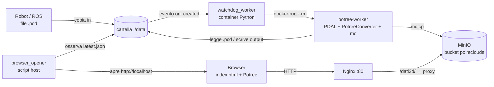
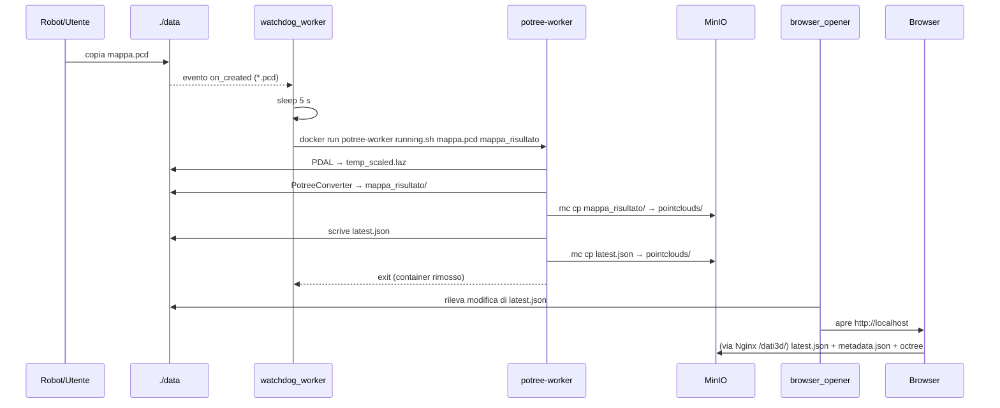

# Potree Pipeline — Documentazione

Pipeline automatizzata che trasforma le nuvole di punti `.pcd` (es. prodotte da un robot/ROS) in un formato navigabile via web con **Potree**, le carica su uno storage a oggetti **MinIO** e le mostra in un visualizzatore 3D servito da **Nginx**.

Basta copiare un file `.pcd` nella cartella `data/`: la conversione, l'upload e l'apertura del browser avvengono in automatico.

---

## Indice

1. [Panoramica dell'architettura](#1-panoramica-dellarchitettura)
2. [Struttura della repository](#2-struttura-della-repository)
3. [Componenti in dettaglio](#3-componenti-in-dettaglio)
4. [Flusso end-to-end](#4-flusso-end-to-end)
5. [Prerequisiti](#5-prerequisiti)
6. [Installazione e primo avvio](#6-installazione-e-primo-avvio)
7. [Utilizzo quotidiano](#7-utilizzo-quotidiano)
8. [Configurazione e parametri](#8-configurazione-e-parametri)

---

## 1. Panoramica dell'architettura



| Servizio | Tecnologia | Ruolo | Porte |
|---|---|---|---|
| `minio` (`minio-storage`) | MinIO | Storage S3-compatibile delle mappe convertite | 9000 (API), 9001 (console web) |
| `nginx` (`nginx_server`) | Nginx | Serve il viewer Potree e fa da reverse proxy verso MinIO | 80 |
| `watchdog_worker` | Python 3.9 + `watchdog` | Osserva `./data` e lancia la conversione per ogni nuovo `.pcd` | — |
| `potree-worker` (immagine, non servizio) | Ubuntu 22.04 + PDAL + PotreeConverter + MinIO client | Container effimero che esegue la conversione e l'upload | — |
| `browser_opener` | PowerShell / Bash (sull'host) | Apre il browser quando una nuova mappa è pronta | — |

---

## 2. Struttura della repository

```
potree_pipeline/
├── docker-compose.yml          # Definisce minio, nginx e watchdog_worker
├── startup.bat                 # Avvio su Windows
├── startup.sh                  # Avvio su Linux/macOS
│
├── data/                       # Cartella "di ingresso" osservata dal watchdog
│   ├── running.sh              # Script di conversione eseguito nel potree-worker
│   ├── latest.json             # Nome dell'ultima mappa elaborata
│   ├── *.pcd                   # Nuvole di punti in ingresso
│   └── *_risultato/            # Output Potree (metadata.json, octree.bin, hierarchy.bin, log.txt)
│
├── watchdog/
│   ├── Dockerfile              # Immagine del watchdog (Python + docker CLI)
│   └── watchdog_data.py        # Logica di monitoraggio della cartella data/
│
├── worker/
│   └── Dockerfile              # Immagine potree-worker (PDAL, PotreeConverter, mc)
│
├── nginx_config/
│   └── nginx.conf              # Configurazione Nginx (static + proxy /dati3d/)
│
├── html_public/                # Document root di Nginx
│   ├── index.html              # Viewer: carica automaticamente l'ultima mappa
│   ├── build/potree/           # Build della libreria Potree
│   └── libs/                   # Dipendenze JS (three.js, jQuery, Cesium, proj4, …)
│
├── scripts/
│   ├── browser_opener.ps1      # Apertura automatica del browser (Windows)
│   └── browser_opener.sh       # Apertura automatica del browser (Linux)
│
└── minio_data/                 # Volume persistente di MinIO (non modificare a mano)
```

---

## 3. Componenti in dettaglio

### 3.1 `docker-compose.yml`

Avvia tre servizi persistenti:

- **minio** — immagine `minio/minio:latest`, credenziali `admin` / `password123`, dati salvati in `./minio_data`. La console di amministrazione è su <http://localhost:9001>.
- **nginx** — monta `./html_public` come document root e `./nginx_config/nginx.conf` come configurazione.
- **watchdog_worker** — costruito da `./watchdog`. Monta:
  - `./data` → `/data` (cartella osservata);
  - `/var/run/docker.sock` → permette al container di **lanciare altri container** sull'host (pattern *Docker-outside-of-Docker*).

  La variabile `HOST_DATA_PATH` contiene il percorso **assoluto sull'host** della cartella `data`. Serve perché, quando il watchdog esegue `docker run -v ...`, il bind mount viene risolto dal demone Docker dell'host, non dal filesystem del container.

### 3.2 Watchdog — `watchdog/watchdog_data.py`

- Usa un `PollingObserver` (il polling è necessario perché gli eventi inotify non si propagano in modo affidabile attraverso i bind mount su Windows/Docker Desktop).
- Reagisce solo alla **creazione** di file che corrispondono a `*.pcd` in `/data` (non ricorsivo).
- Per ogni nuovo file:
  1. attende **5 secondi** per dare a ROS il tempo di finire la scrittura;
  2. calcola il nome della cartella di output: `nomefile.pcd` → `nomefile_risultato`;
  3. esegue:
     ```bash
     docker run --rm --network potree_pipeline_default \
       -v <HOST_DATA_PATH>:/data \
       potree-worker bash running.sh <nomefile.pcd> <nomefile_risultato>
     ```
  4. stampa un messaggio al termine.

Le conversioni sono **sequenziali**: `subprocess.run` è bloccante, quindi più file arrivati insieme vengono elaborati uno alla volta.

### 3.3 Worker — `worker/Dockerfile`

Immagine Ubuntu 22.04 che contiene:

- **PDAL** — conversione e preprocessing della nuvola di punti;
- **PotreeConverter** — compilato dai sorgenti (`github.com/potree/PotreeConverter`) e installato in `/usr/local/bin`;
- **mc** (MinIO Client) — copiato dall'immagine `minio/mc`.

La directory di lavoro è `/data`, quindi `running.sh` e i file `.pcd` sono raggiungibili con percorsi relativi.

> ⚠️ Questa immagine **non** è costruita da `docker-compose`: va costruita a mano con il tag `potree-worker` (vedi [§6](#6-installazione-e-primo-avvio)).

### 3.4 Script di conversione — `data/running.sh`

Eseguito dentro il container `potree-worker` con due argomenti: `<file_input.pcd>` e `<cartella_output>`.

| Passo | Comando | Descrizione |
|---|---|---|
| 1 | `pdal translate ... -f randomize` | Converte il `.pcd` in `temp_scaled.laz`, **randomizza l'ordine dei punti** (migliora la qualità dei livelli di dettaglio di Potree) e imposta una scala di **0.001 (1 mm)** su X/Y/Z. |
| 2 | `PotreeConverter temp_scaled.laz -o <out> --output-format LAZ -s 0.005` | Genera l'octree Potree 2.0 (`metadata.json`, `hierarchy.bin`, `octree.bin`, `log.txt`) con *spacing* iniziale 0.005. |
| 3 | `rm temp_scaled.laz` | Rimuove il file temporaneo. |
| 4 | `mc alias set` + `mc cp -r <out> domain/pointclouds/` | Carica la cartella risultato nel bucket `pointclouds` di MinIO (raggiunto tramite il nome DNS `minio-storage` sulla rete Docker). |
| 5 | scrittura e upload di `latest.json` | Aggiorna `{"ultima_mappa": "<out>"}` sia in `./data` (usato dal browser opener) sia su MinIO (usato dal viewer). |

### 3.5 Nginx — `nginx_config/nginx.conf`

- `location /` → serve i file statici di `html_public` (viewer Potree).
- `location /dati3d/` → **reverse proxy** verso `http://minio:9000/`. Così il browser scarica le nuvole di punti dalla stessa origine del viewer, evitando problemi di CORS.
  Esempio: `http://localhost/dati3d/pointclouds/latest.json` → `http://minio:9000/pointclouds/latest.json`.
- `proxy_buffering off` è utile per lo streaming dei grandi file `octree.bin` (Potree li legge con richieste HTTP *Range*).

### 3.6 Viewer — `html_public/index.html`

1. Crea un `Potree.Viewer` con Eye-Dome Lighting attivo, FOV 60°, budget di 10 milioni di punti, interfaccia in inglese.
2. Scarica `/dati3d/pointclouds/latest.json` per sapere qual è l'ultima mappa.
3. Carica `/dati3d/pointclouds/<ultima_mappa>/metadata.json` con `Potree.loadPointCloud`.
4. Imposta il materiale: dimensione punti adattiva, forma circolare, colorazione per **elevazione**; poi inquadra la scena (`fitToScreen`).

### 3.7 Browser opener — `scripts/browser_opener.ps1` / `.sh`

Script che girano **sull'host** (non in Docker). Ogni 2 secondi controllano la data di ultima modifica di `data/latest.json`; quando cambia (cioè quando `running.sh` ha finito) aprono `http://localhost` nel browser predefinito, poi attendono 10 secondi per evitare aperture multiple.

### 3.8 Script di avvio — `startup.bat` / `startup.sh`

1. `docker-compose up -d` — avvia MinIO, Nginx e il watchdog;
2. avvia il browser opener in background;
3. segue i log del watchdog (`docker logs -f watchdog_worker`) per vedere in tempo reale le conversioni.

---

## 4. Flusso end-to-end



---

## 5. Prerequisiti

- **Docker** e **Docker Compose** (su Windows: Docker Desktop con backend WSL2).
- Connessione a Internet per il primo build (clone di PotreeConverter, download immagini).
- Porte libere sull'host: **80**, **9000**, **9001**.
- Su Windows: PowerShell con permesso di eseguire script (lo `startup.bat` usa `-ExecutionPolicy Bypass`).
- Su Linux: `xdg-open` disponibile per l'apertura automatica del browser.

---

## 6. Installazione e primo avvio

### 6.1 Costruire l'immagine del worker (una sola volta)

Dalla root del progetto:

```bash
docker build -t potree-worker ./worker
```

Il nome `potree-worker` deve corrispondere esattamente a quello usato in `watchdog_data.py`.

### 6.2 Impostare il percorso dei dati

In `docker-compose.yml`, aggiornare `HOST_DATA_PATH` con il percorso **assoluto** della cartella `data` sulla propria macchina:

```yaml
environment:
  - HOST_DATA_PATH=C:\Users\<utente>\Desktop\potree_pipeline\data   # Windows
  # - HOST_DATA_PATH=/home/<utente>/potree_pipeline/data             # Linux
```

### 6.3 Avviare lo stack

Windows:

```bash
startup.bat
```

Linux/macOS:

```bash
./startup.sh
```

### 6.4 Configurare MinIO (solo la prima volta)

Se `minio_data/` è vuota:

1. aprire la console <http://localhost:9001> e accedere con `admin` / `password123`;
2. creare il bucket **`pointclouds`**;
3. impostare l'accesso del bucket su **public** (lettura anonima), altrimenti il viewer riceve `403 Access Denied` quando legge da `/dati3d/`.

In alternativa da riga di comando:

```bash
docker run --rm --network potree_pipeline_default --entrypoint sh minio/mc -c "mc alias set local http://minio-storage:9000 admin password123 && mc mb -p local/pointclouds && mc anonymous set download local/pointclouds"
```

---

## 7. Utilizzo quotidiano

1. Avviare lo stack (`startup.bat` / `startup.sh`).
2. Copiare (o far salvare da ROS) un file `.pcd` nella cartella `data/`.
3. Seguire l'avanzamento nei log del watchdog: `Rilevata nuova mappa…` → `Avvio la conversione…` → `Mappa pronta e caricata su MinIO!`.
4. Il browser si apre su <http://localhost> mostrando l'ultima mappa.

Utili:

| Cosa | Dove |
|---|---|
| Viewer | <http://localhost> |
| Console MinIO | <http://localhost:9001> |
| Una mappa specifica via HTTP | `http://localhost/dati3d/pointclouds/<cartella>/metadata.json` |
| Log del watchdog | `docker logs -f watchdog_worker` |
| Conversione manuale di un file | `docker run --rm --network potree_pipeline_default -v "<HOST_DATA_PATH>:/data" potree-worker bash running.sh file.pcd file_risultato` |
| Fermare tutto | `docker-compose down` |

Per rivisualizzare una mappa precedente, è sufficiente modificare `latest.json` nel bucket `pointclouds` (es. dalla console MinIO) indicando il nome della cartella desiderata.

---

## 8. Configurazione e parametri

| Parametro | File | Valore attuale | Effetto |
|---|---|---|---|
| Credenziali MinIO | `docker-compose.yml`, `data/running.sh` | `admin` / `password123` | Vanno cambiate **in entrambi i file** in modo coerente. |
| `HOST_DATA_PATH` | `docker-compose.yml` | percorso assoluto di `data/` | Bind mount passato al worker. |
| Rete Docker | `watchdog/watchdog_data.py` | `potree_pipeline_default` | Generata da Compose come `<nome_cartella>_default`: se si rinomina la cartella del progetto va aggiornata. |
| Attesa post-creazione | `watchdog/watchdog_data.py` | 5 s | Aumentarla per file molto grandi o scritture lente. |
| Scala LAS | `data/running.sh` | 0.001 | Precisione delle coordinate (1 mm). |
| Spacing PotreeConverter (`-s`) | `data/running.sh` | 0.005 | Densità del livello radice dell'octree. |
| Formato output | `data/running.sh` | `LAZ` | Compressione dei punti in `octree.bin`. |
| Point budget | `html_public/index.html` | 10.000.000 | Punti massimi renderizzati: ridurlo su GPU modeste. |
| Colorazione | `html_public/index.html` | `elevation` | Attributo usato per colorare i punti (es. `rgba`, `intensity`). |
| Intervallo polling opener | `scripts/browser_opener.*` | 2 s | Frequenza di controllo di `latest.json`. |

> Nota: `running.sh` viene letto da `./data` a runtime, quindi le modifiche hanno effetto subito senza ricostruire l'immagine. Le modifiche a `watchdog_data.py` richiedono invece `docker-compose up -d --build`.
